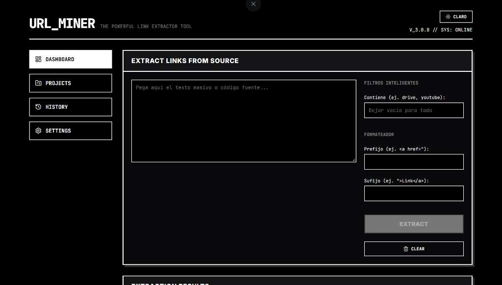
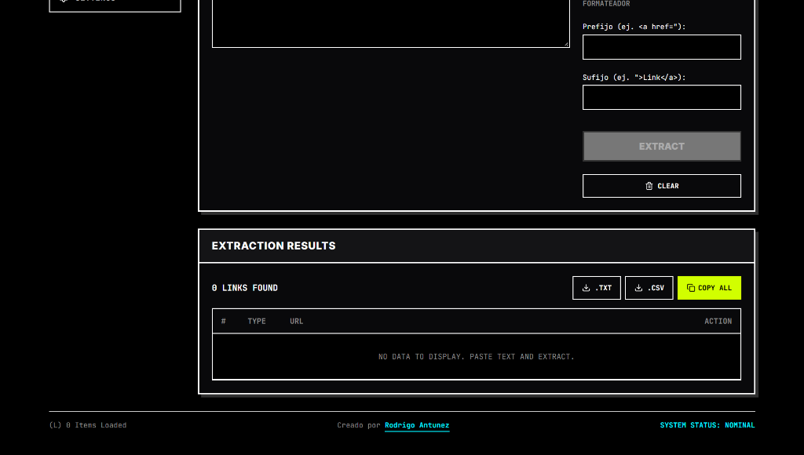

# URL-Miner // Bulk Link Extractor & Live Text Bridge

  
    
  
   
  
<strong>A lightning-fast, privacy-first web utility for bulk extracting, filtering, and formatting URLs + Ephemeral Live Chat & Text Bridge across any device without accounts.</strong>

  <a href="https://rodria45.github.io/URL-Miner/"><strong>Live Demo</strong></a>

---

## English

### Overview
**URL-Miner** is a high-performance web utility designed to process blocks of text or raw HTML to extract, filter, format, and manipulate hyperlinks. In addition, it features **Live Drop**, an ephemeral real-time chat and text bridge that lets users on computers without accounts (public PCs, cyber cafés, locked-down work devices) quickly pass full texts, notes, and links across any other device (computer, tablet, phone) via instant room codes or dynamic QR codes.

Featuring a modern **Neo-Brutalist** aesthetic, the tool provides a seamless, developer-friendly experience.

### Key Features
- **Bulk Extraction:** Automatically filters residual text and isolates valid URLs from raw data.
- **Punctuation Sanitizer:** Strips trailing periods, commas, and parentheses common in natural language or markdown.
- **Live Text Drop (Any Device ⇄ Any Device):** Real-time text room to share texts across devices 100% free with no accounts required.
- **Instant QR Pairing:** Scan with any camera to join the room immediately on another device.
- **Auto-Cleanup / Expiration (TTL):** Messages auto-destruct after 5, 15, 30 min, 1 hour, or via instant purge button.
- **Smart Domain Filtering:** Real-time filtering (e.g., `youtube`, `drive`) to isolate specific domains.
- **Batch Formatting:** Inject custom prefixes and suffixes automatically.
- **Duplicate Handling:** Automatically identifies and removes duplicate URLs.
- **Batch Replacement:** Effortlessly find and replace string parameters across all extracted links.
- **Local History & Settings:** Save and restore previous extractions locally.
- **Export Capabilities:** Export your processed data securely to `.CSV` or `.TXT`.
- **Dual Themes:** Seamlessly toggle between Dark Mode and Light Mode.

### Tech Stack
- **[React.js 19](https://reactjs.org/)** - Modern UI Library
- **[Vite 8](https://vitejs.dev/)** - Next Generation Frontend Tooling
- **QRCode.react** - Instant SVG QR code generator
- **Lucide Icons** - Clean SVG icon library
- **Vanilla CSS3** - Custom Neo-Brutalist design system

---

## Español

### Resumen
**URL-Miner** es una herramienta ultrarrápida diseñada para procesar bloques masivos de texto o código HTML para extraer, filtrar y formatear hipervínculos. Además, incluye la función **Chat en Vivo (Live Drop)**: una sala efímera en tiempo real pensada para personas en computadoras donde no se pueden iniciar cuentas (cibers, oficinas, facultades, computadoras prestadas) para pasarse textos completos, notas y enlaces a cualquier otro dispositivo (otra PC, notebook, tablet, teléfono) al instante, gratis, sin registros y con auto-limpieza configurable.

Con una estética **Neo-Brutalista**, la aplicación ofrece máxima privacidad y agilidad.

### Características Principales
- **Extracción Masiva Inteligente:** Extrae URLs y limpia automáticamente puntos finales, comas y paréntesis sobrantes.
- **Chat en Vivo Efímero (Live Drop):** Envía y recibe textos completos entre cualquier dispositivo en tiempo real, gratis y sin cuentas.
- **Emparejamiento por QR o Código:** Únete a la sala desde otro dispositivo escaneando el código QR o ingresando el código de sala.
- **Auto-Limpieza Configurable (TTL):** Los textos se autodestruyen automáticamente tras 5 min, 15 min, 30 min o 1 hora, o con el botón de purga inmediata.
- **Filtros de Dominio:** Extrae solo enlaces que contengan palabras o dominios específicos (`drive`, `youtube`, etc.).
- **Formateo en Lote:** Aplica prefijos y sufijos personalizados a todos los enlaces extraídos.
- **Control de Duplicados:** Detecta y elimina URLs repetidas mostrando el contador de duplicados.
- **Reemplazo Masivo:** Reemplaza partes de las URLs en lote.
- **Historial Local y Ajustes:** Guarda y restaura sesiones de extracción en `localStorage`.
- **Exportación de Datos:** Descarga los resultados en `.CSV` o `.TXT`.
- **Doble Tema:** Alterna fluidamente entre el Modo Oscuro y el Modo Claro.

### Tecnologías
- **[React.js 19](https://reactjs.org/)** - Biblioteca de interfaz
- **[Vite 8](https://vitejs.dev/)** - Entorno y empaquetador ultrarrápido
- **QRCode.react** - Generación dinámica de QR en el navegador
- **Lucide Icons** - Iconografía moderna
- **Vanilla CSS3** - Sistema de diseño Neo-Brutalista sin frameworks pesados